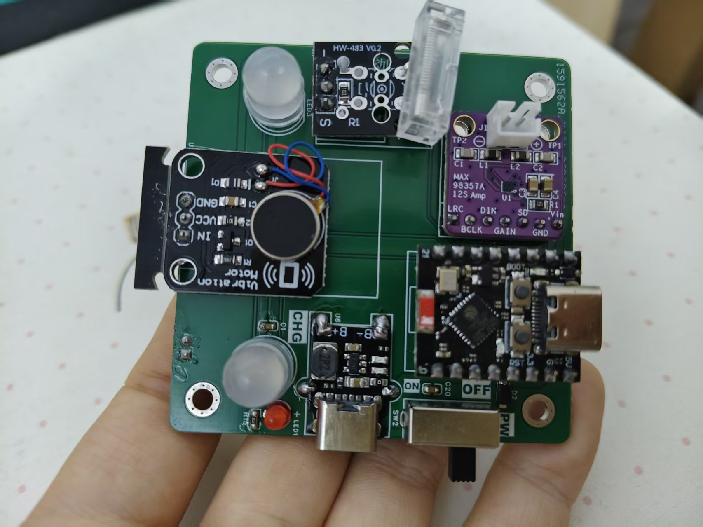
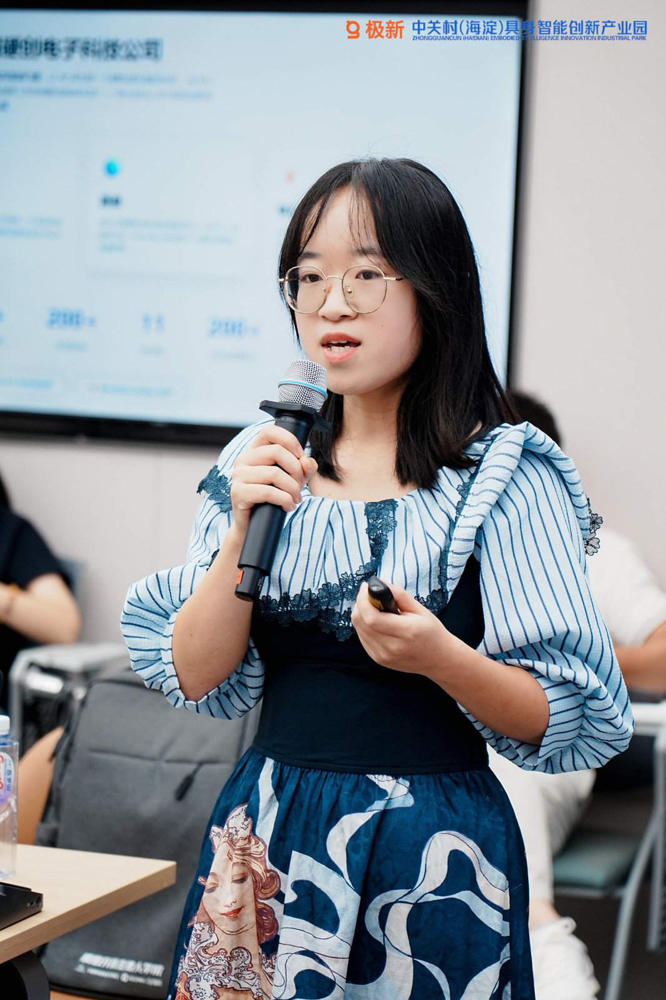
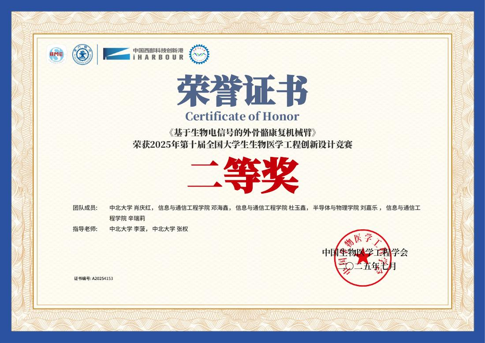
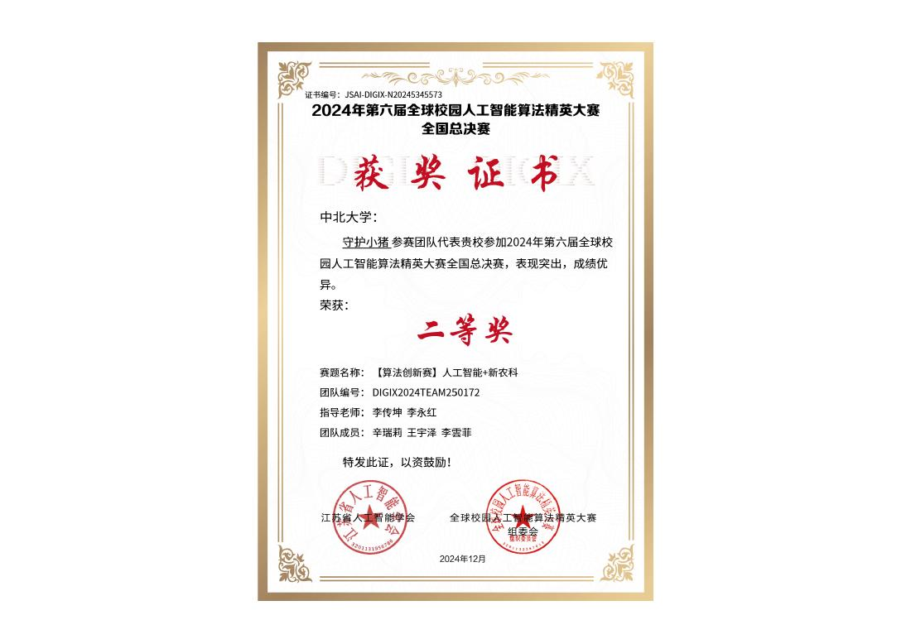
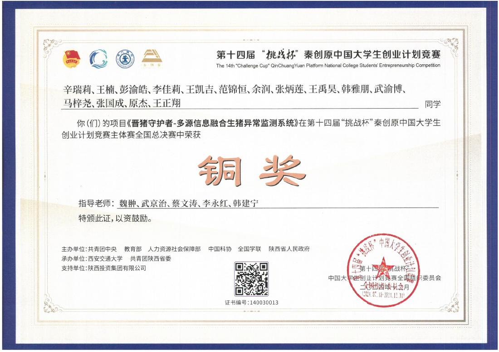
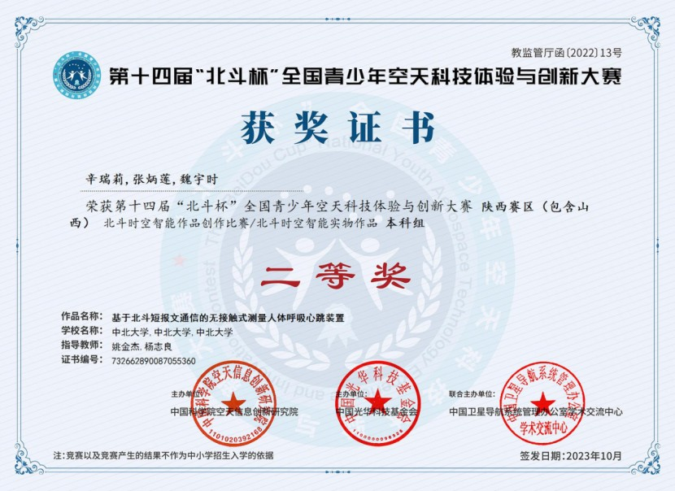

<a href="README.md">简体中文</a> · <strong>English</strong>

# Xin Ruili · 辛瑞莉

### Project Management · Anvol | Smart Hardware, Embedded Prototypes & Maker Education

I help connect requirements, people, prototypes, and documentation in smart hardware and embedded projects. My work includes task coordination, prototype integration, technical writing, and hands-on digital fabrication. This profile presents selected work, personally documented making, and verifiable team achievements.

**Explore:** [Selected work](#selected-work) · [Awards](#awards-and-certificates) · [Intellectual property](#intellectual-property) · [Experience](#experience-and-practice) · [Fab Academy record](https://fabacademy.org/2026/labs/chaihuo/students/xin-ruili/)

| 19 competition award records | 1 granted invention patent | 7 software copyright registrations | 6 work registrations |
| :---: | :---: | :---: | :---: |
| [Certificate archive](achievements/README.md) | [Named co-inventor](intellectual-property/README.md#授权发明专利) | [Registration archive](intellectual-property/README.md#软件著作权登记) | [Registration archive](intellectual-property/README.md#作品著作权登记) |

The counts refer to distinct certificates in the available records. Competition awards include team results, and intellectual property includes joint authorship or rights holders. The linked certificates give the precise scope of each result.

## Selected work

### Contactless respiration and heart-rate monitoring · student prototype

**Role:** student project lead, working with a team. **System path:** mmWave sensing → ESP32 processing → MQTT transmission → remote display.

I coordinated the student project and worked on integration across sensing, communication, and display. A related Beidou Cup entry received second prize in its regional undergraduate category, and a contactless breathing and heartbeat device received third prize at the Shanxi provincial round of the Chinese Collegiate Computing Competition.

[Project notes](projects/contactless-vitals.md) · [Beidou Cup certificate](assets/awards/award-07.jpg) · [Computing competition certificate](assets/awards/award-14.jpg)

This was a demonstration prototype. The available records do not establish a clinical use case or measurement-accuracy claim; the competition entry and later demonstration path are described separately in the project notes.

### Fab Academy 2026 · personal making record

At Chaihuo Makerspace, I documented electronics design, PCB fabrication, embedded programming, 3D printing, assembly, testing, and integration. The weekly assignments show intermediate builds and problems encountered. My final project brings several of those processes together in a desktop device.

[Weekly documentation](https://fabacademy.org/2026/labs/chaihuo/students/xin-ruili/) · [Final project](https://fabacademy.org/2026/labs/chaihuo/students/xin-ruili/final-project.html)

### Technical documentation and learning activities

I contribute to course outlines, hands-on exercises, demonstrations, and project documentation, and support technical learning activities. Four jointly registered tutorial or article works cover innovation projects, electronics and computing competitions, Python parallel computing, and Python object-oriented programming. [See the registration certificates](intellectual-property/README.md#作品著作权登记).

## Awards and certificates

My student-team experience spans electronics, robotics, smart agriculture, computing, and biomedical engineering. The [award archive](achievements/README.md) contains **19 distinct award records with certificate images**, each identified by year, competition level, and team role. Selected examples:

| 2025 · National Biomedical Engineering Innovation Design Competition, second prize | 2024 · Global Campus AI Algorithm Competition national final, second prize |
| --- | --- |
|  |  |
| 2024 · Challenge Cup national final, bronze prize | 2023 · Beidou Cup regional undergraduate division, second prize |
|  |  |

## Intellectual property

- **Granted invention patent:** “Ultrasonic de-icing method, controller, system and medium for wind turbine blades,” patent **ZL 2023 1 1153478.3**. I am a named co-inventor; North University of China is the patent owner. [Certificate](assets/ip/ip-01.jpg).
- **Seven software copyright registrations** name me among the rights holders. They cover vital-sign monitoring, biosignal acquisition and assessment, robotic-arm operation management, and a MicroPython package repository. [Individual records and certificates](intellectual-property/README.md#软件著作权登记).
- **Six work copyright registrations** name me as an author or rights holder. They cover tutorials, technical articles, and visual designs. [Individual records and certificates](intellectual-property/README.md#作品著作权登记).

The archive records exactly what the certificates say; registration does not imply that the source code or full works are publicly released.

## Experience and practice

| Period | Role or program | Focus |
| --- | --- | --- |
| Current | **Project Management · Anvol** | Requirements, task coordination, prototype practice, documentation, and feedback for smart hardware and maker education projects. |
| 2026 | **Fab Academy · Chaihuo Makerspace** | [Personal electronics and digital fabrication record](https://fabacademy.org/2026/labs/chaihuo/students/xin-ruili/). |
| Sep 2024–Sep 2025 | **Head of the Multiphysics Information Intelligent Analysis Practice Base, North University of China** | Fixed-term appointment recorded in the appointment letter; student practice and project organization. |
| 2021–2025 | **B.Eng. in Information Countermeasure Technology, North University of China** | Electronics, laboratory practice, and student team projects. |

Collaborative projects such as pig-health monitoring and biosignal-based rehabilitation devices appear in the award and intellectual-property archives where my name is recorded. Their team nature is indicated there. You can also explore [Anvol](https://anvol.dev) and my [Fab Academy site](https://fabacademy.org/2026/labs/chaihuo/students/xin-ruili/).

Updated November 2026. Claims on this page are limited to the available project records and linked certificates.
