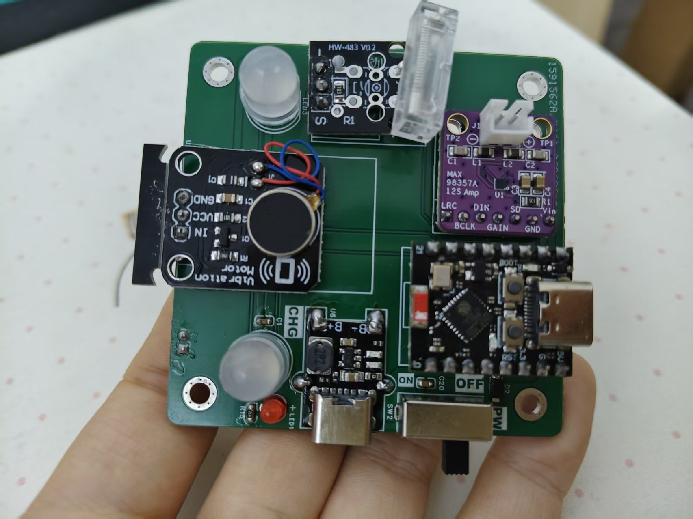
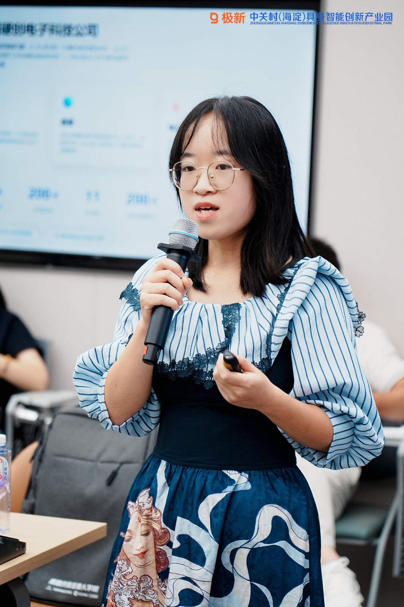

<a href="README.md">English</a> · <strong>简体中文</strong>

# 辛瑞莉 · Xin Ruili

**项目管理 · 智能硬件 · 创客教育**

我在 [Anvol](https://anvol.dev) 从事项目管理，推进智能硬件与创客教育项目中的需求梳理、原型实践、文档整理和反馈沟通。我也参与电子制作与数字制造实践，希望让一个项目既能做出来，也能被使用者和后来参与的人看懂。

[代表实践](#代表实践) · [经历](#经历) · [工作方式](#工作方式) · [English](README.md)

## 代表实践

### Fab Academy 2026 · 个人制作记录

我在柴火创客空间记录了电子设计、PCB 制作、3D 打印、结构装配、嵌入式编程和最终集成的过程。周作业页面保留了中间成果、测试、遇到的问题及解决过程。最终作业以桌面设备串联这些制作环节；这里重点展示我个人的学习与制作过程。

**查看：**[Fab Academy 个人学习记录](https://fabacademy.org/2026/labs/chaihuo/students/xin-ruili/) · [最终制作记录](https://fabacademy.org/2026/labs/chaihuo/students/xin-ruili/final-project.html)

### 无接触式呼吸心跳监测 · 学生原型

我负责过一个探索无接触式呼吸与心跳监测的学生原型项目：用毫米波雷达采集信息，经 ESP32 处理和 MQTT 传输，在查看界面展示结果。我的工作重点是项目组织，以及感知、通信和显示环节的集成。这是演示原型；现有材料不足以支持医疗用途或测量精度的对外承诺。

**查看：**[项目说明与系统流程](projects/contactless-vitals.zh-CN.md)

### 创客教育 · 把项目经验整理成可教学的内容

我参与课程大纲、实操练习、演示与技术文档的整理，支持硬件教学活动和现场指导；将参与者遇到的问题带回项目和课程的下一轮改进。这里重点展示我如何组织、讲解和推进实践，而不是只罗列课程名称。

## 经历

| 时间 | 方向 | 工作内容 |
| --- | --- | --- |
| 现任 | **项目管理 · Anvol** | 推进智能硬件与创客教育项目，负责需求梳理、任务协调、进度跟踪和项目文档；参与样机制作与验证，并整理使用反馈，推动项目改进。 |
| 2026 | **Fab Academy · 柴火创客空间** | 电子设计、嵌入式与数字制造实践，记录并完成最终项目。 |
| 2021—2025 | **中北大学 · 信息对抗技术本科** | 参与实验室、电子制作及学生项目实践。 |

## 工作方式

- **把任务说清楚：**明确使用场景、分工、节点和每一阶段可检查的结果。
- **贴近实物：**在项目协调之外参与装配和测试，理解真实硬件的限制。
- **留下可读记录：**整理技术说明、演示和教学材料，方便他人检查、使用与继续改进。

<strong>更多背景</strong>

本科期间，我参与过嵌入式、感知、机器人及创新竞赛相关的学生项目。其中有些是多人共同完成、已有其他公开仓库记录的项目。这个主页主要展示我自己的制作记录、当前项目工作与近期创客教育实践。

## 联系与交流

智能硬件或创客教育项目可通过 [Anvol](https://anvol.dev) 了解合作方式。也欢迎查看我的 [Fab Academy 记录](https://fabacademy.org/2026/labs/chaihuo/students/xin-ruili/)。

更新于 2026 年 11 月。这个主页重点展示我自己的实践记录，以及我在合作项目中的实际职责。
