# 专利与著作权登记

[返回个人主页](../README.md) · [竞赛获奖证书](../achievements/README.md) · [English summary](../README.en.md)

本页按现有登记证书整理辛瑞莉的共同发明人、共同作者或列名著作权人记录。每项以证书上记载的名称、登记号和权利主体为准。登记证明署名与权利信息，不直接证明个人独立完成全部设计、软件已经开源或作品已经出版。

## 授权发明专利

| 专利 | 署名与权利主体 | 证书 |
| --- | --- | --- |
| 风力发电机叶片的超声波除冰方法、控制器、系统及介质；专利号 ZL 2023 1 1153478.3；2023-11-28 授权。 | 辛瑞莉为列名共同发明人；专利权人为中北大学。 | [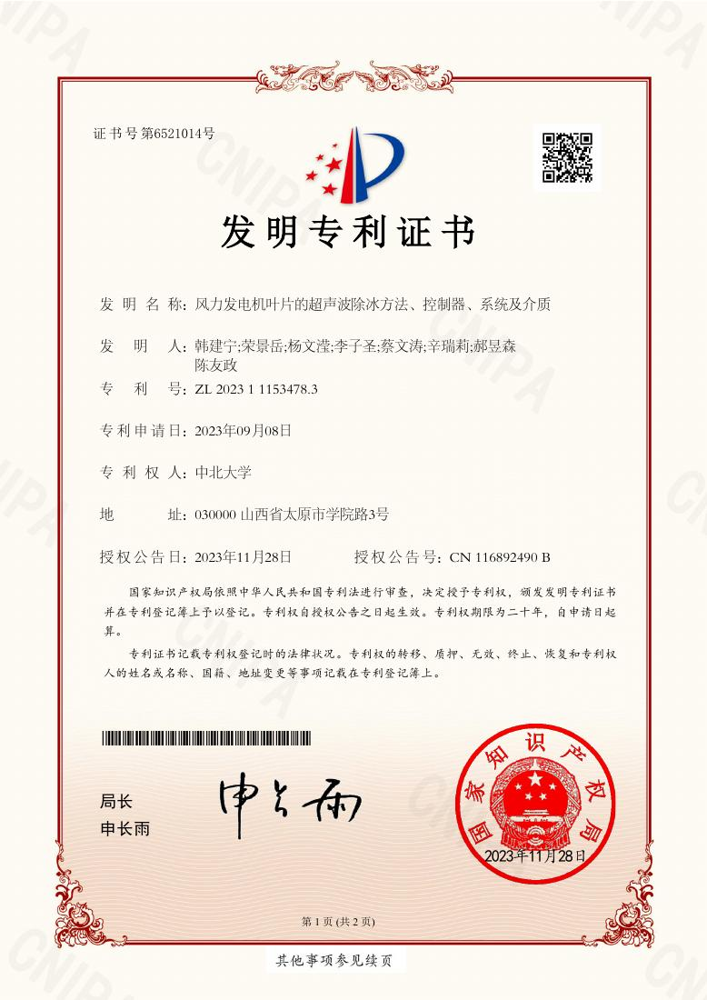](../assets/ip/ip-01.jpg) |

## 软件著作权登记

以下 7 项证书均列有辛瑞莉。多数还列有其他自然人；最后一项同时列有公司及其他自然人。证书展示按登记事实记录，不代表相关软件的源代码可公开使用。

| 登记软件 | 登记号 | 证书 |
| --- | --- | --- |
| 基于毫米波雷达技术的人体体征监测软件 | 2024SR1642606 | [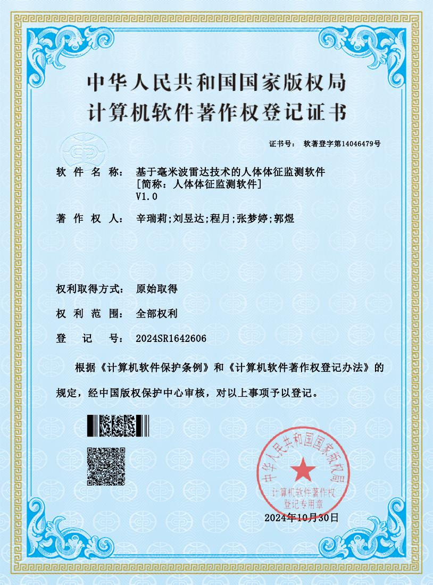](../assets/ip/ip-08.jpg) |
| 多模态心电步态信号采集系统 | 2024SR2073845 |  |
| 精准分拣机械臂操作管理软件 | 2025SR0105971 | [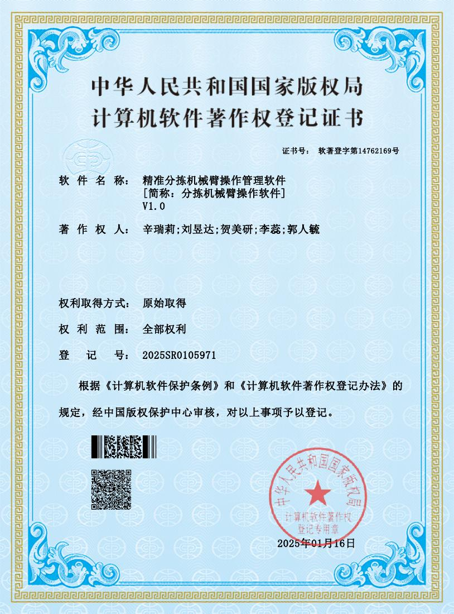](../assets/ip/ip-10.jpg) |
| 肌电信号监测评估软件 | 2024SR2004857 | [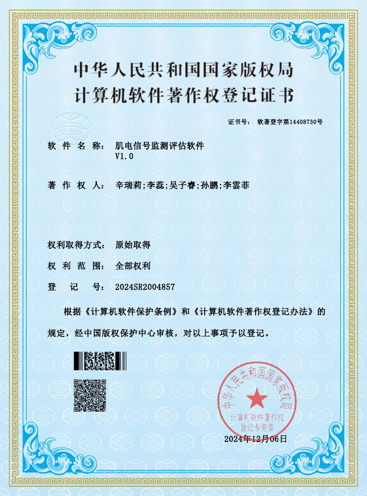](../assets/ip/ip-11.jpg) |
| 表面肌电信号采集软件 | 2024SR1215382 | [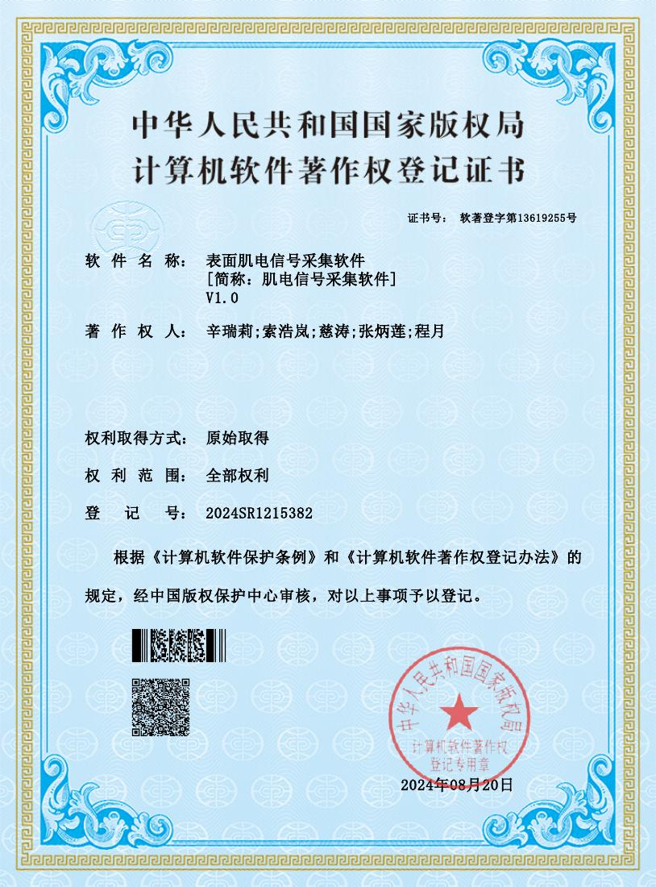](../assets/ip/ip-12.jpg) |
| 人体肌电信号健康评估软件 | 2025SR0229226 | [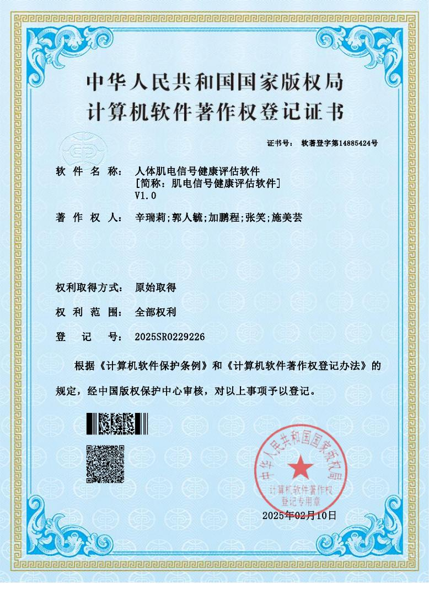](../assets/ip/ip-13.jpg) |
| uPyPi MicroPython MIP 软件包仓库管理平台 | 2026SR0603186；登记著作权人为太原青禾之道科技有限公司、李子圣、辛瑞莉。 | [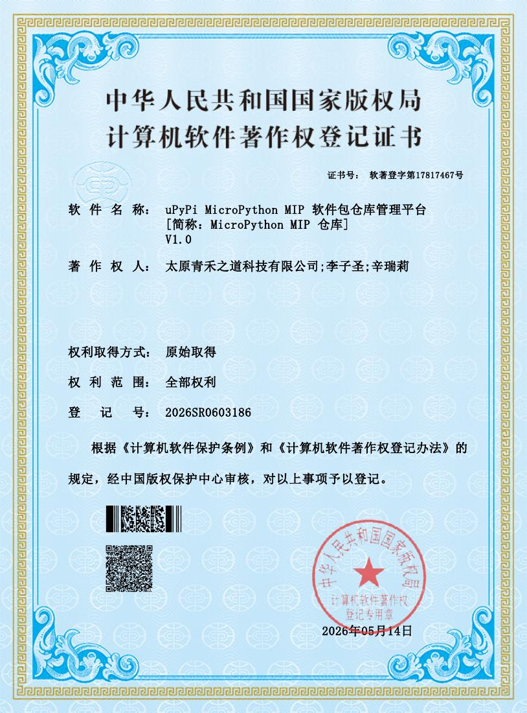](../assets/ip/ip-14.jpg) |

## 作品著作权登记

这 6 项涵盖教学内容、技术文章与视觉作品。证书列有辛瑞莉为作者或权利人；部分为多人或公司共同署名。登记事实与公开出版、课程交付分别看待。

| 登记作品 | 类型与署名说明 | 证书 |
| --- | --- | --- |
| 大学生创新创业教程 | 教程文字作品；共同署名 | [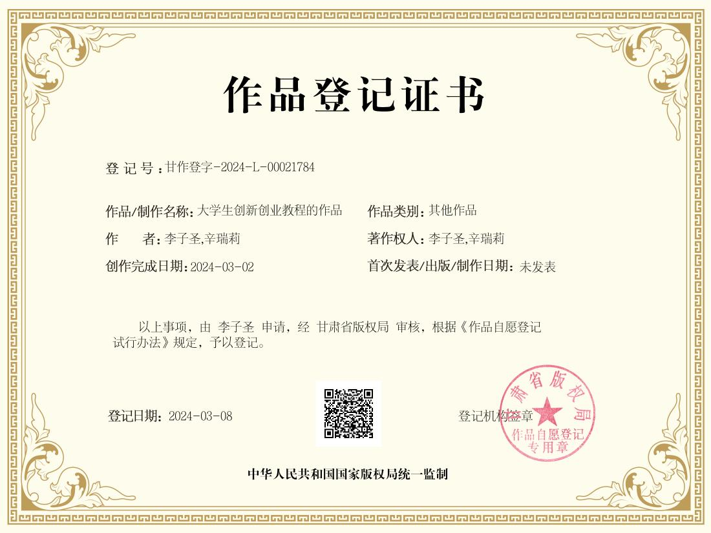](../assets/ip/ip-02.jpg) |
| 大学生电子计算机类比赛教程 | 教程文字作品；共同署名 | [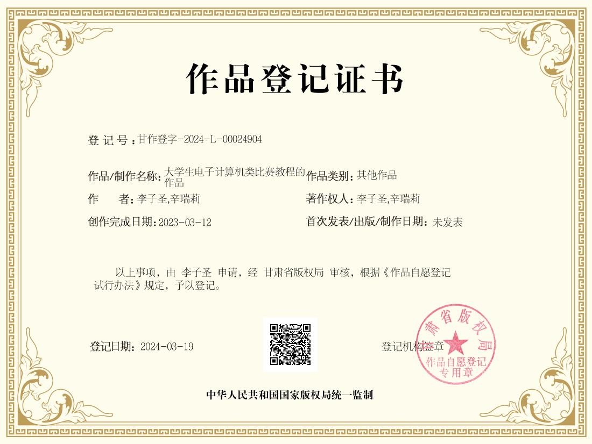](../assets/ip/ip-03.jpg) |
| 一文速通 Python 并行计算 | 技术文章；共同署名 | [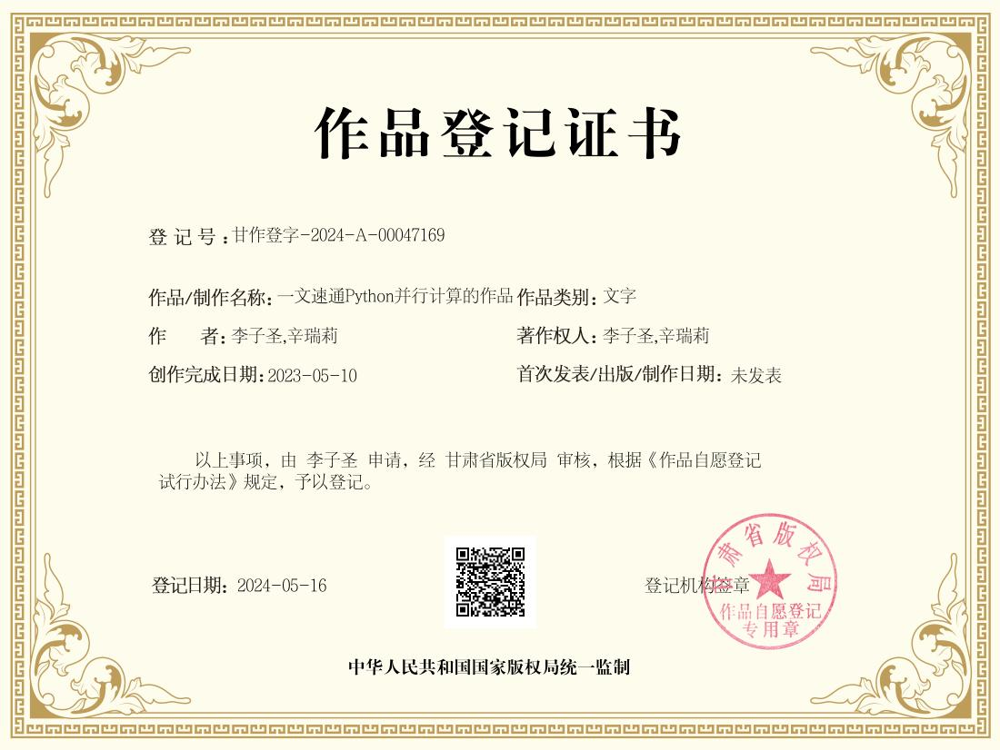](../assets/ip/ip-04.jpg) |
| 一文速通 Python 面向对象编程 | 技术文章；共同署名 | [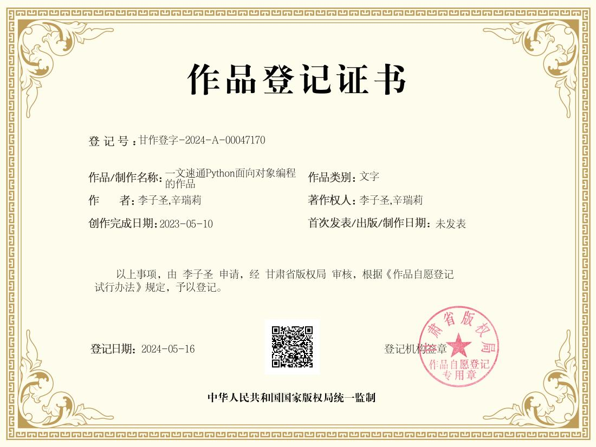](../assets/ip/ip-05.jpg) |
| Freak 嵌入式工作室 LOGO | 美术作品；李子圣、辛瑞莉共同署名 | [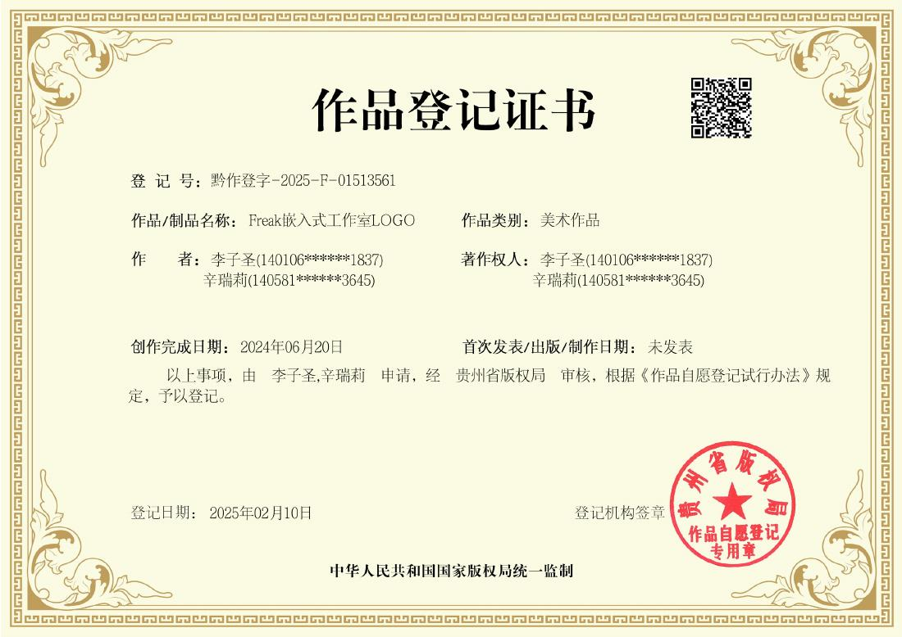](../assets/ip/ip-06.jpg) |
| 灵韵启航者模块图标 | 美术作品；辛瑞莉与其他自然人及公司共同署名 | [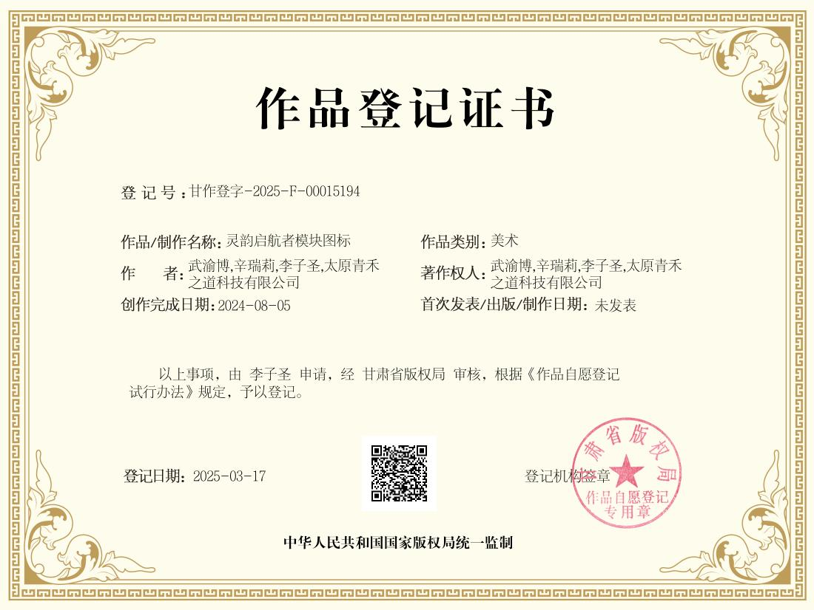](../assets/ip/ip-07.jpg) |

本页仅是个人公开履历中的署名记录。证书图片保留了登记机构和共同署名信息；如需使用或许可相关作品，应分别确认实际权利主体与许可条件。
