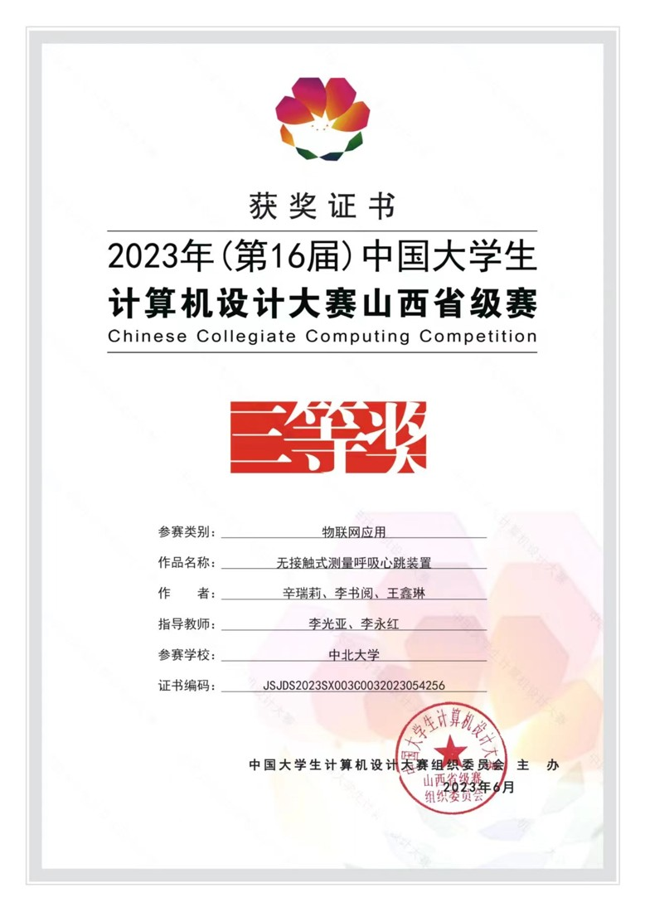

<a href="contactless-vitals.md">English</a> · <strong>简体中文</strong>

# 无接触式呼吸心跳监测原型

**学生项目 · 中北大学 · 2023**

这个项目探索在不贴附电极的情况下获取呼吸与心跳相关信号。团队制作了以毫米波雷达、ESP32、网络传输和远程查看界面组成的演示装置。

## 系统流程

这个原型把信息采集、设备处理和远程显示串联起来。我作为项目负责人组织项目工作，并参与设备联网和查看链路的集成；这是团队合作的学生项目。

## 已有记录

- 2026 年个人简介记录了装置实物及设备连接与查看方式。
- 团队凭包含北斗短报文通信的相关无接触式测量装置，获得 **2023 年“北斗杯”陕西赛区（包含山西）本科组二等奖**。
- 团队凭无接触式测量呼吸心跳装置，获得 **2023 年中国大学生计算机设计大赛山西省级赛三等奖**。

| 北斗杯赛区二等奖 | 计算机设计大赛山西省级赛三等奖 |
| --- | --- |
|  |  |

竞赛名称对应当时提交的版本。上方流程图依据后来个人简介中展示的毫米波雷达、ESP32 和 MQTT 演示链路整理，不代表所有竞赛版本使用完全相同的电路与通信方式。

## 项目边界

这是学生演示原型。现有材料不足以证明临床性能或具体测量精度，因此这里不作医疗用途声明。若要发布可复现的完整工程，还需整理电路文件、固件、测试条件与测量数据。

[← 返回个人主页](../README.md) · [查看完整竞赛证书目录](../achievements/README.md)
